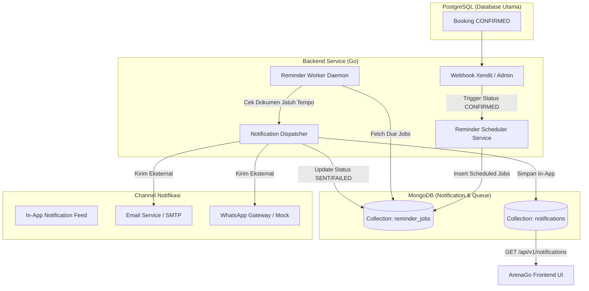

# Rencana Implementasi: Notifikasi Pengingat Jadwal Bermain (MongoDB)

Dokumen ini memuat arsitektur, desain skema, alur kerja, dan tahapan implementasi fitur **Notifikasi Pengingat Jadwal Bermain** pada sistem **Booking-Lapangan (ArenaGo)** dengan memanfaatkan **MongoDB** sebagai *notification storage & job scheduler*.

---

## 1. Latar Belakang & Alasan Pemilihan MongoDB

### Masalah yang Diselesaikan
Penyewa lapangan sering kali lupa jadwal bermain atau terlambat datang ke lapangan padel. Dengan adanya pengingat terjadwal (misal: H-24 jam dan H-2 jam sebelum jadwal mulai), risiko *no-show* berkurang, pengalaman pengguna meningkat, dan operasional lapangan lebih teratur.

### Mengapa MongoDB (Hybrid Architecture bersama PostgreSQL)?
Sistem inti ArenaGo saat ini menggunakan **PostgreSQL** untuk data relasional bertransaksi ketat (Users, Fields, Bookings, Payments, Schedules). MongoDB dipilih sebagai pelengkap spesifik untuk fitur notifikasi karena:
1. **Pemisahan Beban (Decoupling Transactional vs Notification/Log)**:
   Query notifikasi (polling, unread badges, history log) tidak membebani database utama (PostgreSQL) yang menangani lock ketersediaan slot dan transaksi pembayaran.
2. **Skema Fleksibel (Document-Based)**:
   Payload notifikasi dapat berbeda-beda tergantung saluran (In-App, WhatsApp, Email, Push Notification) dan dapat menyimpan metadata dinamis (nama lapangan, jam main, tautan Google Maps lapangan, nomor telepon pengelola).
3. **Time-To-Live (TTL) Indexes Bawaan**:
   MongoDB memiliki fitur *TTL Index* yang secara otomatis menghapus notifikasi lama (misalnya setelah 30 atau 60 hari) tanpa memerlukan cron query `DELETE` berat di PostgreSQL.
4. **Idempotency & Tracking State**:
   Mendukung index majemuk unik (`booking_id` + `reminder_type`) untuk mencegah duplikasi pengiriman notifikasi pengingat secara absolut.

---

## 2. Arsitektur & Alur Kerja Sistem



### Skenario Alur:
1. **Jadwal Dibuat / Dikonfirmasi**:
   - Ketika pembayaran booking diverifikasi (`models.BookingStatusConfirmed`), sistem memicu pembuatan dokumen di koleksi `reminder_jobs` di MongoDB.
   - Jadwal pengingat yang dibuat:
     - **H-24 Jam**: Pengingat persiapan bermain (dikirim 24 jam sebelum `StartTime`).
     - **H-2 Jam**: Pengingat keberangkatan & persiapan perlengkapan (dikirim 2 jam sebelum `StartTime`).
2. **Ekskusi Pengingat (Background Worker)**:
   - Worker berjalan setiap interval tertentu (misal: tiap 1 atau 2 menit).
   - Mengambil job dengan status `SCHEDULED` yang `scheduled_for <= NOW()`.
   - Mengubah status ke `PROCESSING`, memproses pengiriman notifikasi (memasukkan ke koleksi `notifications` untuk In-App dan opsional email/WA).
   - Menandai job menjadi `SENT` atau `FAILED` (dengan batas retry).
3. **Pembatalan / Reschedule**:
   - Jika booking dibatalkan (`CANCELLED`), job di `reminder_jobs` otomatis diperbarui menjadi `CANCELLED`.
4. **Konsumsi Pengguna**:
   - Pengguna login melihat badge unread di icon lonceng navbar.
   - Pengguna dapat membaca daftar notifikasi dan menandai sudah dibaca (*mark as read*).

---

## 3. Desain Koleksi MongoDB

### 3.1. Koleksi: `reminder_jobs`
Menyimpan antrean jadwal pengingat untuk setiap booking yang valid.

```json
{
  "_id": ObjectId("652c7a..."),
  "booking_id": 105,
  "booking_code": "AG-20261016-001",
  "user_id": 12,
  "user_name": "Budi Santoso",
  "user_email": "budi@example.com",
  "user_phone": "08123456789",
  "field_id": 2,
  "field_name": "Lapangan Padel A",
  "booking_date": "2026-10-18T00:00:00Z",
  "start_time": "16:00",
  "end_time": "18:00",
  "play_time": ISODate("2026-10-18T16:00:00+07:00"),
  "reminder_type": "H_24",
  "scheduled_for": ISODate("2026-10-17T16:00:00+07:00"),
  "status": "SCHEDULED",
  "retry_count": 0,
  "max_retries": 3,
  "sent_at": null,
  "error_message": "",
  "created_at": ISODate("2026-10-16T19:00:00Z"),
  "updated_at": ISODate("2026-10-16T19:00:00Z")
}
```

**Index yang Dibutuhkan:**
- Unique compound: `{ booking_id: 1, reminder_type: 1 }` (Mencegah job kembar).
- Query index: `{ status: 1, scheduled_for: 1 }` (Optimasi query worker yang mencari job jatuh tempo).

---

### 3.2. Koleksi: `notifications`
Menyimpan notifikasi yang tampil pada kotak masuk (inbox) user di frontend aplikasi.

```json
{
  "_id": ObjectId("652c8b..."),
  "user_id": 12,
  "booking_id": 105,
  "booking_code": "AG-20261016-001",
  "title": "Pengingat Jadwal Bermain (H-2 Jam)",
  "message": "Halo Budi, jadwal main padel Anda di Lapangan Padel A dimulai 2 jam lagi (16:00 WIB). Siapkan raket Anda!",
  "type": "REMINDER_MATCH",
  "channels": ["IN_APP", "EMAIL"],
  "is_read": false,
  "read_at": null,
  "data": {
    "field_name": "Lapangan Padel A",
    "start_time": "16:00",
    "end_time": "18:00",
    "date": "2026-10-18"
  },
  "created_at": ISODate("2026-10-18T14:00:00+07:00"),
  "expires_at": ISODate("2026-11-17T14:00:00+07:00")
}
```

**Index yang Dibutuhkan:**
- User query index: `{ user_id: 1, is_read: 1, created_at: -1 }` (Untuk filter unread & pagination inbox).
- TTL index: `{ expires_at: 1 }` dengan `expireAfterSeconds: 0` (Auto cleanup notifikasi usang setelah 30 hari).

---

## 4. Rencana Struktur Kode Backend (Go)

Perubahan dan penambahan file pada backend:

```text
Booking-Lapangan/
├── config/
│   ├── env.go                   # Tambah MongoConfig (URI, DB, ReminderInterval)
│   └── mongodb.go               # Inisialisasi koneksi mongo.Client
├── models/
│   └── notification.go          # Struct model Go untuk Notification & ReminderJob (BSON tags)
├── repository/
│   ├── notification_repository.go # Interface & impl MongoDB Notification (Inbox)
│   └── reminder_repository.go     # Interface & impl MongoDB ReminderJob (Queue)
├── controllers/
│   ├── notification_controller.go # Logika bisnis inbox notifikasi
│   └── payment_controller.go     # Hook: Buat reminder saat status CONFIRMED
├── handler/
│   └── notification_handler.go   # HTTP handler Gin untuk endpoints notifikasi
├── worker/
│   ├── booking_expirer.go        # (Existing)
│   └── reminder_worker.go        # Worker daemon pengecek reminder jatuh tempo
├── router/
│   └── router.go                 # Registrasi route notifikasi user & admin
└── main.go                       # Inisialisasi MongoDB client & jalankan reminder worker
```

---

## 5. Konfigurasi Environment Baru (`.env`)

```ini
# ---------- MongoDB (Notification & Reminder) ----------
MONGO_URI=mongodb://localhost:27017
MONGO_DATABASE=arenago_notifications
REMINDER_WORKER_INTERVAL_SECOND=60
REMINDER_H24_ENABLED=true
REMINDER_H2_ENABLED=true
```

---

## 6. Spesifikasi API Endpoint Baru

### 6.1. User Endpoints (Memerlukan Token JWT)
1. **`GET /api/v1/notifications`**
   - Mengambil daftar notifikasi milik user yang sedang login.
   - Query params: `page` (default 1), `limit` (default 10), `unread_only` (`true|false`).
2. **`GET /api/v1/notifications/unread-count`**
   - Mengembalikan jumlah notifikasi yang belum dibaca (untuk badge icon lonceng).
3. **`PATCH /api/v1/notifications/:id/read`**
   - Menandai satu notifikasi tertentu sebagai sudah dibaca (`is_read: true`).
4. **`PATCH /api/v1/notifications/read-all`**
   - Menandai seluruh notifikasi user sebagai sudah dibaca.

### 6.2. Admin Endpoints (Role: ADMIN)
1. **`GET /api/v1/admin/reminders`**
   - Memantau log antrean pengingat (`reminder_jobs`) dengan filter status (`SCHEDULED`, `SENT`, `FAILED`).
2. **`POST /api/v1/admin/reminders/:id/retry`**
   - Trigger manual untuk pengingat yang berstatus `FAILED`.

---

## 7. Rencana Integrasi Frontend (ArenaGO Next.js)

1. **Komponen Header / Navbar**:
   - Tambahkan icon lonceng notifikasi di samping nama profil user.
   - Tampilkan dot merah / badge angka jika `unread-count > 0`.
2. **Popover / Drawer Notifikasi**:
   - Menampilkan daftar notifikasi ringkas dengan penanda warna (misal: hijau untuk jadwal baru, biru/kuning untuk pengingat jadwal).
   - Tombol "Tandai Semua Sudah Dibaca".
   - Klik kartu notifikasi mengarahkan langsung ke detail booking (`/history-booking` atau dialog detail).

---

## 8. Langkah-Langkah Eksekusi (Roadmap)

| Tahap | Aktivitas | File Terkait |
|---|---|---|
| **Fase 1** | Driver & Koneksi MongoDB | `go.mod` (tambah `go.mongodb.org/mongo-driver/v2/mongo`), `config/env.go`, `config/mongodb.go` |
| **Fase 2** | Definisi Model & Repository | `models/notification.go`, `repository/notification_repository.go`, `repository/reminder_repository.go` |
| **Fase 3** | Logic Penjadwalan saat Booking Confirmed | `controllers/payment_controller.go`, `controllers/booking_controller.go` (Hook cancel) |
| **Fase 4** | Background Reminder Worker | `worker/reminder_worker.go`, integrasi di `main.go` |
| **Fase 5** | REST API Notifikasi | `controllers/notification_controller.go`, `handler/notification_handler.go`, `router/router.go` |
| **Fase 6** | UI Navbar & Notifikasi Frontend | `ArenaGO-padel-frontend/src/components/...` |
| **Fase 7** | Pengujian & Verifikasi | Unit test & integrasi simulasi waktu pengingat |
