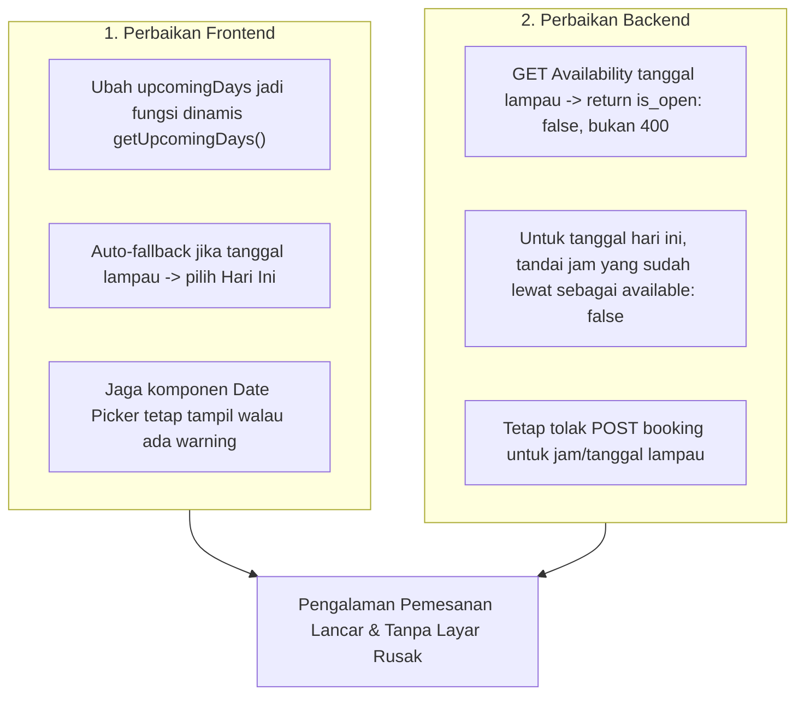

# Rencana Perbaikan: Error "date must not be in the past" pada Pemilihan Jadwal Lapangan

Dokumen ini memuat analisis akar penyebab (*root cause analysis*), strategi mitigasi, dan rencana perbaikan terstruktur untuk masalah error **"date must not be in the past"** yang muncul saat pengguna membuka halaman pemilihan slot/detail booking lapangan (`/jadwal/:courtId`).

---

## 1. Analisis Akar Masalah (Root Cause Analysis)

### Kronologi Error
Saat pengguna membuka halaman pemilihan jadwal lapangan (`SelectSlot.jsx`), layar menampilkan teks error merah:
```text
date must not be in the past
```
Akibatnya seluruh komponen antarmuka pemilihan slot tertutup dan pengguna tidak dapat memilih tanggal maupun slot bermain.

### Akar Masalah Teknis

1. **Array Tanggal Statis di Frontend (`mockData.js`)**:
   Pada [ArenaGO-padel-frontend/src/lib/mockData.js](file:///Users/rizkifauzan/Documents/Booking-Lapangan/ArenaGO-padel-frontend/src/lib/mockData.js#L90), tanggal `upcomingDays` dibuat sebagai *top-level module constant*:
   ```javascript
   export const upcomingDays = Array.from({ length: 7 }).map((_, i) => {
     const d = new Date();
     d.setDate(d.getDate() + i);
     return d;
   });
   ```
   - Kode ini dieksekusi **hanya satu kali** saat modul JavaScript pertama kali di-load ke memori browser.
   - Ketika server development atau tab browser dibiarkan menyala melewati pergantian tengah malam (misal dibuka kemarin 16 Oktober dan diakses kembali hari ini 17 Oktober), `upcomingDays[0]` tetap bernilai tanggal kemarin (`2026-10-16`).
   - Halaman `SelectSlot.jsx` langsung mengirimkan request `GET /api/v1/fields/1/availability?date=2026-10-16`.

2. **Validasi Keras (Hard Error 400) di Backend (`field_controller.go`)**:
   Pada [controllers/field_controller.go](file:///Users/rizkifauzan/Documents/Booking-Lapangan/controllers/field_controller.go#L168-L170):
   ```go
   if bookingDate.Before(timeutil.Today()) {
       return nil, apperror.BadRequest("date must not be in the past")
   }
   ```
   - Backend menolak mentah-mentah query ketersediaan tanggal lampau dengan melempar HTTP 400 Bad Request.
   - Mengambil ketersediaan (`Availability`) adalah query pembacaan (`GET`). Melempar error fatal 400 merusak *user experience* karena membuat frontend macet total, alih-alih menampilkan bahwa slot tanggal tersebut sudah lewat atau tidak tersedia.

3. **Penanganan Error Rentan di UI (`SelectSlot.jsx`)**:
   Pada [ArenaGO-padel-frontend/src/pages/SelectSlot.jsx](file:///Users/rizkifauzan/Documents/Booking-Lapangan/ArenaGO-padel-frontend/src/pages/SelectSlot.jsx#L57):
   ```javascript
   if (error) return <div className="px-5 py-20 text-center text-sm text-red-600">{error}</div>;
   ```
   - Jika query `availability` mengembalikan error, komponen langsung me-return layar kosong dengan pesan error saja.
   - Komponen tanggal di atasnya ikut hilang sehingga pengguna tidak bisa mengklik tombol "Besok" untuk pulih dari error tanpa merefresh browser.

---

## 2. Rencana Solusi & Perbaikan



---

## 3. Rincian Langkah Implementasi

### Langkah 1: Perbaikan Frontend (Dynamic Date & Resilient UI)
1. **Fungsi Dinamis Pembuat Tanggal**:
   - Di `ArenaGO-padel-frontend/src/lib/mockData.js`, ubah `upcomingDays` menjadi fungsi:
     ```javascript
     export function getUpcomingDays(count = 7) {
       const today = new Date();
       today.setHours(0, 0, 0, 0);
       return Array.from({ length: count }).map((_, i) => {
         const d = new Date(today);
         d.setDate(today.getDate() + i);
         return d;
       });
     }
     ```
   - Pertahankan ekspor `upcomingDays` dengan *Proxy / Getter* atau panggil `getUpcomingDays()` di dalam `useMemo` pada komponen terkait agar kompatibilitas kode lain tetap terjaga.

2. **Perbaikan Halaman Pemilihan Slot (`SelectSlot.jsx`)**:
   - Gunakan `useMemo(() => getUpcomingDays(), [])` di dalam `SelectSlot`.
   - Jika terjadi error pada tanggal tertentu, jangan hancurkan seluruh layar. Tampilkan banner peringatan di area slot, namun pemilih tanggal tetap aktif sehingga pengguna dapat memilih hari lain.

3. **Perbaikan Dashboard Admin (`AdminDashboard.jsx`)**:
   - Gunakan `getUpcomingDays()` dinamis agar tab pemilihan jadwal admin selalu sinkron dengan tanggal kalender terbaru.

---

### Langkah 2: Perbaikan Backend (Graceful Availability & Time Check)
1. **Endpoint `Availability` yang Toleran (`field_controller.go`)**:
   - Ubah logika `Availability` agar **tidak melempar HTTP 400** jika tanggal sebelum hari ini:
     ```go
     if bookingDate.Before(timeutil.Today()) {
         // Kembalikan respons yang valid dengan seluruh slot bertanda available: false
         response.IsOpen = false
         return response, nil
     }
     ```
2. **Penyaringan Jam yang Sudah Lewat untuk Hari Ini**:
   - Jika `bookingDate.Equal(timeutil.Today())`, periksa jam saat ini (`time.Now()`).
   - Slot dengan `end_time` atau `start_time` yang sudah lewat di hari yang sama otomatis ditandai `available: false` dengan alasan `"past_time"`, sehingga user tidak bisa memilih jam 08:00 pagi jika sekarang sudah jam 14:00 siang.
3. **Validasi Pembuatan Booking Tetap Ketat (`booking_controller.go`)**:
   - Pada `POST /api/v1/bookings`, validasi tanggal dan jam lampau tetap dipertahankan dengan pesan yang jelas (`booking_date must not be in the past`).

---

## 4. Rencana Pengujian (Test Plan)

1. **Backend Unit Testing**:
   - Query availability untuk tanggal kemarin $\rightarrow$ mengembalikan response 200 OK dengan slot kosong/tidak tersedia, bukan error 400.
   - Query availability untuk hari ini $\rightarrow$ jam yang sudah lewat bertanda `available: false`.
   - Pembuatan booking untuk tanggal lampau $\rightarrow$ tetap ditolak dengan 422 Unprocessable Entity.
2. **Frontend UI Testing**:
   - Buka `/jadwal/:courtId` saat sesi dibiarkan melewati tengah malam $\rightarrow$ tanggal otomatis mulai dari hari ini.
   - Simulasi memilih tanggal hari ini $\rightarrow$ slot jam lampau berstatus *disabled / booked*.

---

## 5. Estimasi File yang Akan Dimodifikasi

| No | File | Deskripsi Perubahan |
|---|---|---|
| 1 | `ArenaGO-padel-frontend/src/lib/mockData.js` | Mengubah array tanggal statis menjadi fungsi dinamis `getUpcomingDays()`. |
| 2 | `ArenaGO-padel-frontend/src/pages/SelectSlot.jsx` | Memperbarui pemanggilan tanggal dan membuat UI toleran terhadap error. |
| 3 | `ArenaGO-padel-frontend/src/pages/AdminDashboard.jsx` | Menggunakan daftar hari dinamis. |
| 4 | `controllers/field_controller.go` | Mengganti error 400 pada `Availability` menjadi respons kosong/non-aktif yang aman. |
| 5 | `controllers/field_controller_test.go` | Menambahkan unit test pengujian tanggal lampau dan slot hari ini. |
