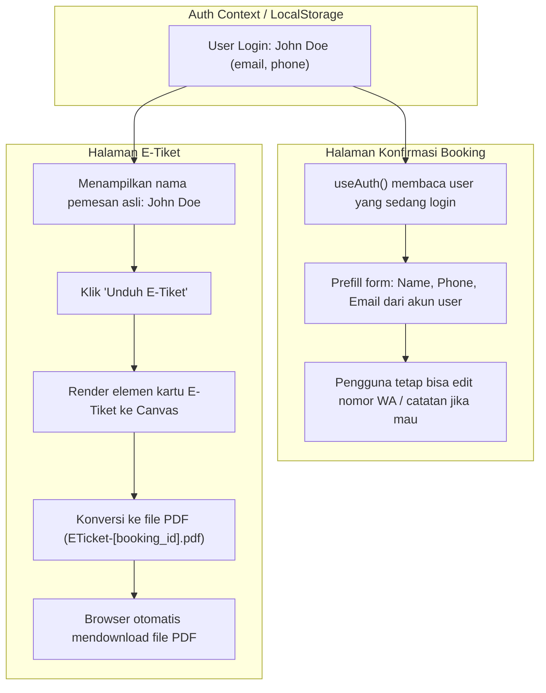

# Rencana Perbaikan: Download E-Tiket PDF & Profil Pemesan Otomatis

Dokumen ini memuat analisis akar penyebab, strategi penyelesaian, dan langkah implementasi untuk dua masalah berikut:
1. **E-Tiket belum bisa di-download sebagai PDF**:
   Tombol "Unduh E-Tiket" di halaman E-Tiket belum memiliki handler dan belum menghasilkan dokumen PDF yang siap diunduh.
2. **Data Pemesan Otomatis Terisi "Raka Pratama"**:
   Ketika pengguna membuka alur booking (halaman Konfirmasi Booking), field Nama Lengkap, Nomor WhatsApp, dan Email otomatis terisi data dummy ("Raka Pratama", "+62 812-3456-7890", "raka.pratama@email.com") dari `mockData.js`, padahal akun yang sedang login adalah akun asli pengguna (misal: "John Doe").

---

## 1. Analisis Akar Masalah (Root Cause Analysis)

### Masalah 1: Tombol Unduh E-Tiket Belum Berfungsi
- Di [ArenaGO-padel-frontend/src/pages/ETicket.jsx](file:///Users/rizkifauzan/Documents/Booking-Lapangan/ArenaGO-padel-frontend/src/pages/ETicket.jsx#L55):
  ```jsx
  <Button variant="secondary" className="w-full" icon={<Icon name="download" size={18} />}>
    Unduh E-Tiket
  </Button>
  ```
- Tombol ini tidak memiliki properti `onClick` atau fungsi generator PDF.
- Sebelumnya belum terinstal pustaka generator PDF seperti `jspdf` dan `html2canvas`.

### Masalah 2: Form Konfirmasi Memakai Mock Data Raka Pratama
- Di [ArenaGO-padel-frontend/src/pages/Confirmation.jsx](file:///Users/rizkifauzan/Documents/Booking-Lapangan/ArenaGO-padel-frontend/src/pages/Confirmation.jsx#L16-L26):
  ```javascript
  const booking = state?.court
    ? {
        ...sampleBooking,
        court: state.court,
        date: state.date,
        slots: state.slots?.length ? state.slots : sampleBooking.slots,
        totalOverride: state.court.pricePerHour * (state.slots?.length || sampleBooking.slots.length),
      }
    : sampleBooking;

  const [form, setForm] = useState(booking.customer);
  ```
- `sampleBooking.customer` di [mockData.js](file:///Users/rizkifauzan/Documents/Booking-Lapangan/ArenaGO-padel-frontend/src/lib/mockData.js#L118) bernilai:
  ```javascript
  customer: {
    name: "Raka Pratama",
    phone: "+62 812-3456-7890",
    email: "raka.pratama@email.com",
  }
  ```
- Halaman `Confirmation.jsx` tidak menyambungkan `useAuth()` atau membaca session `arenago:session` dari `localStorage`, sehingga profil pengguna yang aktif (`user.name`, `user.email`, `user.phone`) diabaikan dan selalu ditimpa oleh data Raka.
- Begitu pula di [BookingDetail.jsx](file:///Users/rizkifauzan/Documents/Booking-Lapangan/ArenaGO-padel-frontend/src/pages/BookingDetail.jsx#L162), fungsi `toETicketBooking` membuat data customer statis `{ name: "Pemesan", phone: "", email: "" }` tanpa mengambil nama akun user.

---

## 2. Rencana Solusi & Arsitektur



---

## 3. Langkah Implementasi Detil

### Langkah 1: Profil Akun Dinamis pada Form Booking (`Confirmation.jsx`)
- Import `useAuth` dari `../context/AuthContext`.
- Tentukan default nilai form berdasarkan akun login:
  ```javascript
  const { user } = useAuth();
  const defaultCustomer = {
    name: user?.name || "",
    phone: user?.phone || "",
    email: user?.email || "",
  };
  ```
- Inisialisasi state `form` dengan `defaultCustomer`.
- Tambahkan `useEffect` agar saat data `user` ter-load (misal dari async fetch), form otomatis terisi jika sebelumnya masih kosong.

### Langkah 2: Profil Akun pada E-Tiket & Detail Booking
- Di [BookingDetail.jsx](file:///Users/rizkifauzan/Documents/Booking-Lapangan/ArenaGO-padel-frontend/src/pages/BookingDetail.jsx):
  - Teruskan profil `user` ke fungsi `toETicketBooking(booking, user)` sehingga E-Tiket menampilkan nama pemesan aktual (`user?.name || "Pemesan"`).
- Di [ETicket.jsx](file:///Users/rizkifauzan/Documents/Booking-Lapangan/ArenaGO-padel-frontend/src/pages/ETicket.jsx):
  - Mengambil nama pemesan dari `booking.customer?.name` atau `user?.name`.

### Langkah 3: Implementasi Download E-Tiket PDF (`ETicket.jsx`)
- Menambahkan referensi `useRef` pada kartu E-Tiket (`ticketRef`).
- Membuat fungsi `downloadPdf()` menggunakan pustaka `html2canvas` dan `jspdf`:
  1. `html2canvas(ticketRef.current, { scale: 2, useCORS: true })` untuk menghasilkan gambar beresolusi tinggi tanpa blur.
  2. Menghitung rasio dimensi A4 atau ukuran pas kartu tiket.
  3. Menyimpan file dengan nama `ETicket-${booking.id}.pdf`.
  4. Menambahkan state `downloading` pada tombol unduh agar memberikan feedback visual saat proses rendering PDF berlangsung.
- Menyediakan fallback cetak `@media print` jika pengguna ingin mencetak langsung melalui dialog print browser.

---

## 4. Validasi & Pengujian
1. Verifikasi alur booking:
   - Login dengan akun (misal `John Doe` / email user).
   - Masuk ke pemilihan slot lapangan -> Klik "Lanjut ke Konfirmasi".
   - Pastikan field Nama Lengkap menampilkan **John Doe**, email menampilkan email akun, dan nomor telepon terisi sesuai nomor akun.
2. Verifikasi download PDF:
   - Buka halaman E-Tiket.
   - Klik tombol "Unduh E-Tiket".
   - Pastikan file `ETicket-[kode].pdf` terdownload secara otomatis dan dapat dibuka dengan tampilan rapi, memuat barcode/QR, detail lapangan, dan nama pemesan yang benar.
3. Jalankan `npm run build` dan pastikan tidak ada error kompilasi.
