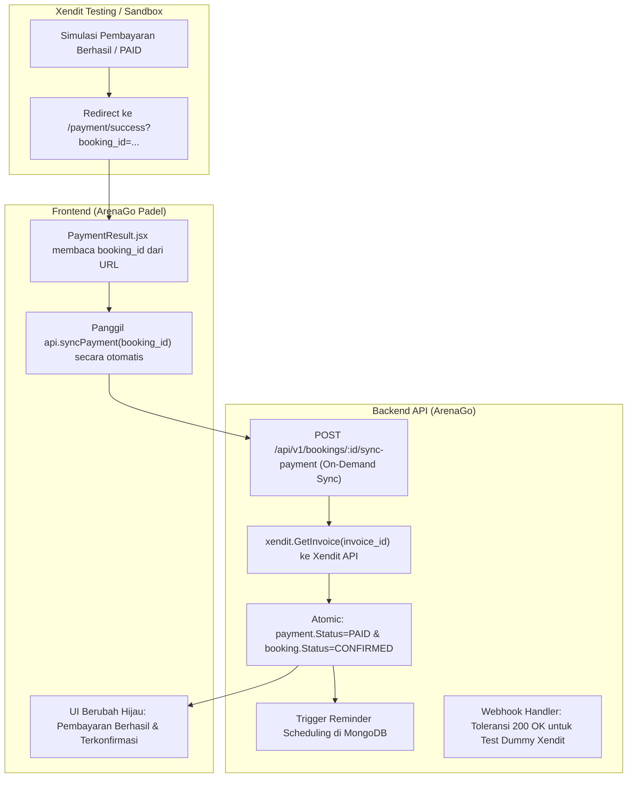

# Rencana Perbaikan: Masalah Verifikasi Pembayaran & Sinkronisasi Status Xendit

Dokumen ini memuat analisis akar penyebab, strategi penyelesaian, dan langkah implementasi untuk masalah:
1. Pesan error **"verifikasi pembayaran not found"** (404 Not Found) saat callback webhook Xendit / testing.
2. Pembayaran sudah berhasil dilakukan di simulator/testing Xendit namun status di sistem ArenaGo **tidak otomatis terkonfirmasi** (tertahan di status "Menunggu pembayaran" / belum berubah menjadi CONFIRMED).

---

## 1. Analisis Akar Masalah (Root Cause Analysis)

### Masalah 1: Error "payment not found" pada Webhook Xendit Testing
- Di [controllers/payment_controller.go](file:///Users/rizkifauzan/Documents/Booking-Lapangan/controllers/payment_controller.go#L66):
  ```go
  payment, err := r.Payment().FindByExternalID(ctx, verified.ExternalID)
  ```
  Saat developer menguji webhook di dashboard Xendit (tombol *"Test & Send Callback"*), Xendit mengirimkan payload pengujian tiruan dengan `external_id` bawaan Xendit (misal: `test1596701831` atau `sample-invoice-123`).
- Karena `external_id` dummy tersebut tidak ada di database PostgreSQL lokal kita, repository melempar error `404 Not Found: "payment not found"`.
- Dashboard Xendit menganggap callback gagal (karena mengharapkan HTTP `200 OK`).

### Masalah 2: Pembayaran Xendit Berhasil tetapi Status Belum Terkonfirmasi
- **Ketiadaan Jalur Webhook ke Localhost**:
  Xendit berjalan di cloud internet. Saat dijalankan secara lokal di komputer (`http://localhost:8080`), server Xendit tidak dapat mengirim webhook `POST /api/v1/payments/webhook` ke localhost tanpa tunneling publik (seperti ngrok).
- **Halaman Hasil Pembayaran Hanya Polling Pasif**:
  Halaman [PaymentResult.jsx](file:///Users/rizkifauzan/Documents/Booking-Lapangan/ArenaGO-padel-frontend/src/pages/PaymentResult.jsx) hanya membaca ulang database lokal (`api.bookingPayment`) tanpa memicu verifikasi langsung ke server Xendit (*on-demand reconciliation*).
- **Hilangnya Konteks Booking pada Redirect URL**:
  Xendit redirect URL (`/payment/success`) tidak membawa parameter `booking_id`. Jika `localStorage` terhapus atau pembayaran diselesaikan di tab/perangkat lain, sistem tidak mengetahui booking mana yang baru dibayar.

---

## 2. Rencana Solusi & Perbaikan



---

## 3. Rincian Langkah Implementasi

### Langkah 1: Backend On-Demand Payment Sync & Reconciliation
1. **Endpoint `SyncPaymentStatus` di `PaymentController`**:
   - Menerima `bookingID` dari user yang terautentikasi.
   - Mengambil data invoice terbaru dari server Xendit melalui `c.invoices.GetInvoice(ctx, payment.InvoiceID)`.
   - Jika status invoice di Xendit sudah `PAID` atau `SETTLED`:
     - Perbarui `payment.Status = models.PaymentStatusPaid` (beserta `paid_at`, `payment_method`, `payment_channel`).
     - Perbarui `booking.Status = models.BookingStatusConfirmed`.
     - Jadwalkan reminder pengingat jadwal bermain di MongoDB via `c.notif.ScheduleRemindersForBooking`.
   - Jika status invoice di Xendit `EXPIRED`:
     - Perbarui `payment.Status = models.PaymentStatusExpired` dan `booking.Status = models.BookingStatusExpired`.
2. **Route HTTP Baru**:
   - `POST /api/v1/bookings/:id/sync-payment` (dengan middleware `Authenticate`).
   - `POST /api/v1/payments/sync/:external_id` (opsional untuk audit/admin).

### Langkah 2: Toleransi Webhook Testing Xendit Dashboard
1. Pada `HandleWebhook` di `controllers/payment_controller.go`:
   - Jika `FindByExternalID` mengembalikan `apperror.IsNotFound(err)`:
     - Catat log bahwa ini adalah webhook uji coba / external_id tidak ditemukan.
     - Kembalikan `200 OK` (`return nil`), sehingga fitur *Test Webhook* di dashboard Xendit mendapatkan respons sukses.

### Langkah 3: Penyempurnaan Redirect URL & Parameter Booking
1. Pada `controllers/booking_controller.go` (`Create`):
   - Sisipkan query params pada redirect URL:
     - `success_redirect_url: ".../payment/success?booking_id=123&booking_code=AG-..."`
     - `failure_redirect_url: ".../payment/failed?booking_id=123&booking_code=AG-..."`

### Langkah 4: Sinkronisasi Otomatis di Frontend
1. Di `ArenaGO-padel-frontend/src/lib/api.js`:
   - Tambahkan fungsi `syncPayment: (bookingId) => request("/bookings/" + bookingId + "/sync-payment", { method: "POST" })`.
2. Di `ArenaGO-padel-frontend/src/pages/PaymentResult.jsx`:
   - Ambil `booking_id` dari URL query parameter atau `localStorage`.
   - Saat halaman dibuka, langsung panggil `api.syncPayment(bookingId)` untuk mencocokkan status ke Xendit.
   - Begitu status `PAID` / `CONFIRMED`, tampilan langsung berubah menjadi sukses (*Terkonfirmasi*) tanpa perlu menunggu webhook eksternal.
3. Di `ArenaGO-padel-frontend/src/pages/BookingDetail.jsx`:
   - Tambahkan tombol "Cek Status Pembayaran" jika booking masih berstatus `WAITING_PAYMENT`.

---

## 4. Rencana Pengujian
1. Unit testing pada `controllers/payment_controller_test.go` untuk method `SyncPaymentStatus` dan `HandleWebhook` testing dummy.
2. Pengujian integrasi lokal dengan API Xendit Sandbox.
3. Build frontend dan pengujian UI.
